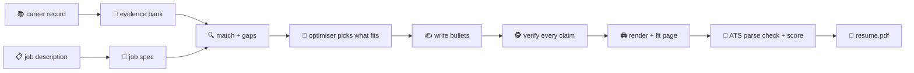

<div align="center">

# 😂 haha

### one guy · 106 projects · one page · zero lies

*A machine that turns a 250 KB career record into a one-page resume a robot can parse and a human can love, in the 7.4 seconds they'll spend on it.*


</div>

---

## 🤔 The problem

Kanishk has built a symbolic ARC-AGI-3 agent, a 56,000-record translation evaluation, a Rust inference harness, an EEG seizure detector, a top-250 Amazon ML Challenge entry, and roughly 101 other things.

A recruiter has **7.4 seconds** and one page.

An applicant tracking system (ATS) has **no feelings**, a strong opinion about two-column layouts, and will happily read your "fi" ligature as `�`.

Somebody has to decide which four projects make it onto the page. That somebody is now a Python package. It's called `haha` because the alternative was crying.

## ✨ What it does

You give it:

1. 📚 **The master career record**: everything, ever, with every caveat attached.
2. 📋 **A job description**: the one you're applying to today, probably at 2 a.m.

It gives you a resume that:

- **parses cleanly** in Workday, Greenhouse, Lever and friends: one column, real text, no icons smuggled into the header;
- **says what the job asked for**, in the job's own words, but only where the evidence actually supports it;
- **cites a source for every bullet**, so no claim on the page is invented (the robots are already better than us at most things, they don't need to be better at lying too);
- **fits on the page** without shrinking the font to 6pt like an animal.

## 🏭 How it works



| Stage | Module | What it does | Vibe |
|:---:|---|---|---|
| 0 | `bank` | Career record → atomic, citable claims, each keeping its conditions | Marie Kondo, but for a CV |
| – | `masters` | Five role-track masters, loaded into Resume-Matcher | five versions of you, all real |
| 1 | `jobspec` | Job description → weighted requirements, keywords, deal-breakers, which ATS they use | reading between the bullet points |
| 2 | `match` | Requirement → supporting claims, plus an honest gap report | "do you *actually* know Kubernetes" |
| 3 | `selection` | An OR-Tools optimiser picks what fits the page budget | knapsack problem, but it's your life |
| 4 | `write` | Bullets in the job's vocabulary, each citing its claims | ghostwriter with a conscience |
| 5 | `verify` | Every number, date, name and skill checked against the evidence | the fact-checker nobody invited |
| 6 | `render` | PDF/DOCX that fits the page | Tetris |
| 7 | `ats` | Resume-Matcher parse check, round trip and score | letting the robot pre-judge you, privately |

> **Status:** stages 0–1 work: `uv run tailor bank` compiles the career record into a citable evidence bank, and `uv run tailor job <url>` reads a posting into a grounded job spec with a knockout check. Stages 2–7 are still docstrings and dreams, and politely say so.

## 🚀 Running it

**1. Wake up the robot** (Resume-Matcher API on `:8000`, web app on `http://127.0.0.1:3000`):

```bash
scripts/start-servers.sh
```

**2. Ask the robot how it's doing:**

```bash
bin/rm get_status
```

**3. Build the evidence bank** (writes `../haha-data/bank/` and its `REPORT.md`):

```bash
uv run tailor bank
```

`uv run tailor bank --annotate` writes one review prompt per entry to `../haha-data/work/annotate/`; the reviewed overlays go in `../haha-data/annotations/` and are re-applied on every build.

**4. Read a job** (Greenhouse, Ashby or Lever URL, or a `.md` file):

```bash
uv run tailor job https://job-boards.greenhouse.io/anthropic/jobs/5198255008
```

This writes `posting.md` and a prompt pack to `../haha-data/applications/<company>-<role>-<date>/`. Claude fills `jobspec.json` from the pack; then

```bash
uv run tailor job --check anthropic-research-engineer
```

checks that every requirement quotes the posting verbatim, and writes `knockouts.md` (visa, location, degree, years) using `../haha-data/candidate.yaml` and the opportunity database's gate.

**5. Make sure the plumbing is plumbed:**

```bash
uv run pytest
```

**6. Put the robot back to sleep:**

```bash
scripts/stop-servers.sh
```

In the Claude desktop app, the `rm-backend` and `rm-frontend` launch configs do steps 1 and 4 for you.

## 🗺️ Where things live

```text
haha/                    code only, safe to open-source
├── src/career_tailor/   one module per stage
├── tests/               unit tests run on a synthetic record; `local` tests use yours
├── templates/           RenderCV/Typst theme, if we outgrow the built-ins
├── vendor/resume-matcher/  Resume-Matcher submodule (agent mode, no API key)
├── bin/rm               run any Resume-Matcher tool: bin/rm --help
└── scripts/             start/stop the servers

../haha-data/            personal data, never committed (HAHA_DATA_DIR)    🙈
├── bank/                the evidence bank, every claim with receipts
├── annotations/         reviewed overlays that survive bank rebuilds
├── record_updates.yaml  dated corrections that supersede a record fact
├── masters/             optional Resume-Matcher track masters
├── jobs/                job descriptions go in here, done/ when finished
├── applications/        one folder per application
└── work/                prompt packs and scratch files
```

The career record is read from `../outputs/KANISHK_PAUL_MASTER_CAREER_RECORD.md` (override with `HAHA_CAREER_RECORD`).

## 📜 House rules

1. **Never invent anything.** Not a skill, metric, date, title or employer. If it isn't in the career record, it doesn't exist. Sorry, "10x engineer".
2. **Team wins stay team wins.** Amazon and Blindfold were team efforts; we name who did which part.
3. **Numbers keep their conditions.** "2.23% on 25 public games, explore-then-replay" is a real result. "Solved 13 games" is fan fiction.
4. **Strongest reasonable version, always.** Modesty is great at dinner parties and terrible at the resume screen.
5. **Don't edit `vendor/`.** We borrow Resume-Matcher, we don't remodel its kitchen.

## 🧑‍🔧 Fresh clone?

```bash
git clone --recurse-submodules https://github.com/kanishkpaul/haha.git
```

Then follow `vendor/resume-matcher/SETUP.md`: `uv sync` and `uv run playwright install chromium` in the backend, `npm install` in the frontend. Set `LLM_PROVIDER=agent` in `vendor/resume-matcher/apps/backend/.env`, because in this house, Claude does the writing and Resume-Matcher does the judging.

## 🙏 Standing on the shoulders of

- [**Resume-Matcher**](https://github.com/srbhr/Resume-Matcher): stores, validates, scores, parse-checks and renders. Does the robot's job so we don't have to guess what the robot thinks.
- [**RenderCV**](https://github.com/rendercv/rendercv): LaTeX-quality PDFs without having to learn LaTeX (again).
- [**OR-Tools**](https://developers.google.com/optimization): for deciding which of 106 projects get a seat on the bus.

---

<div align="center">

*Built with ☕, existential dread, and a strong belief that a resume should be true **and** good.*

**haha.** 🫠

</div>
