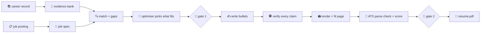

<div align="center">

# 😂 haha

### one guy · 106 projects · one page · zero lies

*A machine that turns a 250 KB career record into a one-page resume a robot can parse and a human can love, in the 7.4 seconds they'll spend on it.*


</div>

---

## 🤔 The problem

Kanishk has built a symbolic ARC-AGI-3 agent, a 56,000-record translation evaluation, a Rust inference harness, an EEG seizure detector, a top-250 Amazon ML Challenge entry, and roughly 101 other things.

A recruiter has **7.4 seconds** and one page.

An applicant tracking system (ATS) has **no feelings**, a strong opinion about two-column layouts, and will happily read your "fi" ligature as `�`.

Somebody has to decide which four projects make it onto the page. That somebody is now a Python package. It's called `haha` because the alternative was crying.

## ✨ What it does

You give it:

1. 📚 **The master career record**: everything, ever, with every caveat attached.
2. 📋 **A job posting**: the one you're applying to today, probably at 2 a.m.

It gives you a resume that:

- **parses cleanly** in Workday, Greenhouse, Lever and friends: one column, real text, no icons smuggled into the header;
- **says what the job asked for**, in the posting's exact words, but only where the record actually describes that work;
- **cites a source for every line**, down to the record line and the proof card, so nothing on the page is invented (the robots are already better than us at most things, they don't need to be better at lying too);
- **fits on the page** without shrinking the font to 6pt like an animal.

## 🚀 Quick start

```bash
uv sync                                                                  # once
uv run tailor bank                                                       # compile the career record
uv run tailor run https://job-boards.greenhouse.io/anthropic/jobs/5198255008
uv run tailor status                                                     # what's next, for every job
```

`tailor run` does everything it can and stops when it needs a brain or a human:

- 🧠 **A prompt pack to fill.** Reading the posting, judging the evidence, writing bullets and reviewing the page are Claude's job, done right here in the session. No API key, no hidden calls. Python does the checking: every answer is validated before the run moves on.
- 🙋 **A gate.** Gate 1: approve the plan. Gate 2: approve the page. `tailor run <name> --approve`, one gate per approval. Change the plan afterwards and it asks again.

```text
$ uv run tailor status
anthropic  gate 2    grade C ATS 49.2  review check_report.md and the PDF, then tailor run anthropic --approve
metr       gate 2    grade A ATS 33.5  review check_report.md and the PDF, then tailor run metr --approve
prime      gate 2    grade A ATS 60.2  review check_report.md and the PDF, then tailor run prime --approve
```

Everything for one job lands in `../haha-data/applications/<company>-<role>-<date>/`: the PDF, DOCX and plain text, `check_report.md`, `gap_report.md`, `plan.md` and `provenance.json`. The working files hide in its `work/` folder. The full tour, plus pins, bans and other knobs, is in **[docs/workflow.md](docs/workflow.md)**.

## 🏭 How it works



| Stage | Module | What it does | Vibe |
|:---:|---|---|---|
| 0 | `bank` | Career record → atomic, citable claims, each keeping its conditions and proof | Marie Kondo, but for a CV |
| 1 | `jobspec` | Posting → weighted requirements quoted verbatim, keywords, deal-breakers | reading between the bullet points |
| 2 | `match` | Requirement → supporting claims, plus an honest gap report | "do you *actually* know Kubernetes" |
| 3 | `selection` | An OR-Tools optimiser picks what fits the page | knapsack problem, but it's your life |
| 4 | `write` | Bullets in the posting's vocabulary, each citing its claims | ghostwriter with a conscience |
| 5 | `verify` | Numbers, names, conditions and ownership checked; a strict screener reads the page | the fact-checker nobody invited |
| 6 | `render` | RenderCV/Typst PDF and a DOCX that fit the page, read back to be sure | Tetris |
| 7 | `ats` | Resume-Matcher's parse check and keyword score | letting the robot pre-judge you, privately |
| 8 | `assemble` | Provenance for every line, the two gates, `tailor status` | the paper trail |

<details>
<summary>🔧 <b>Running one stage at a time</b></summary>

`tailor run` chains these; you rarely need them alone.

| Command | Does |
|---|---|
| `uv run tailor bank` | Compiles the record into `../haha-data/bank/` and writes `REPORT.md`. `--annotate` writes review prompts for the per-entry overlays. |
| `uv run tailor job <url\|file>` | Fetches a Greenhouse, Ashby or Lever posting (or reads a file) and writes the job-spec prompt. `--check <name>` validates `jobspec.json` and writes `knockouts.md`. |
| `uv run tailor plan <name>` | Writes the match prompt, then validates `match.json`, writes `gap_report.md` and plans the page into `plan.md`. |
| `uv run tailor write <name>` | Writes the write prompt, then guards `draft.json` and writes `draft.md`. |
| `uv run tailor check <name>` | Fact-checks, renders, fits, parse-checks and scores the page, then grades it from `review.json`. |
| `uv run pytest` | Makes sure the plumbing is plumbed. |

</details>

<details>
<summary>🤖 <b>Resume-Matcher's web app (optional)</b></summary>

haha only needs Resume-Matcher's command line (`bin/rm`), which runs offline and writes nothing to its database. If you want its web app and tracker too:

```bash
scripts/start-servers.sh    # API on :8000, web app on http://127.0.0.1:3000
bin/rm get_status
scripts/stop-servers.sh
```

</details>

## 🗺️ Where things live

```text
haha/                     code only, safe to open-source
├── src/career_tailor/    one module per stage, plus cli.py
├── tests/                run on a synthetic record; `local` tests use the real one
├── docs/                 workflow guide, build plan, resume research
├── vendor/resume-matcher/  Resume-Matcher submodule (agent mode, no API key)
├── bin/rm                any Resume-Matcher tool: bin/rm --help
└── scripts/              start/stop Resume-Matcher's servers

../haha-data/             personal data, never committed (HAHA_DATA_DIR)    🙈
├── bank/                 the evidence bank, every claim with receipts
├── annotations/          reviewed overlays that survive bank rebuilds
├── record_updates.yaml   dated corrections that supersede a record fact
├── candidate.yaml        visa, location, start date: facts the record doesn't hold
├── calibration.yaml      measured lines per page, so plans fit first time
├── jobs/                 drop job descriptions here: tailor run acme.md
└── applications/         one folder per application
```

The career record is read from `../outputs/KANISHK_PAUL_MASTER_CAREER_RECORD.md` and proof cards from `../evidence/` (override with `HAHA_CAREER_RECORD`, `HAHA_PROOF_DIR`).

## 📜 House rules

1. **Never invent anything.** Not a skill, metric, date, title or employer. If it isn't in the career record, it doesn't exist. Sorry, "10x engineer".
2. **Lost receipts aren't lies.** Everything in the record is true. A project whose repo died in 2024 counts the same as one with a link; it just gets a "have the story ready" note.
3. **Team wins stay team wins.** Amazon and Blindfold were team efforts; we name who did which part.
4. **Numbers keep their conditions.** "2.23% on 25 public games, explore-then-replay" is a real result. "Solved 13 games" is fan fiction.
5. **Strongest reasonable version, always.** Modesty is great at dinner parties and terrible at the resume screen.
6. **Don't edit `vendor/`.** We borrow Resume-Matcher, we don't remodel its kitchen.

## 🧑‍🔧 Fresh clone?

```bash
git clone --recurse-submodules https://github.com/kanishkpaul/haha.git
cd haha && uv sync
```

For Resume-Matcher's parse check and score, follow `vendor/resume-matcher/SETUP.md`: `uv sync` and `uv run playwright install chromium` in its backend, and `LLM_PROVIDER=agent` in `vendor/resume-matcher/apps/backend/.env`. In this house, Claude does the writing and Resume-Matcher does the judging.

## 🙏 Standing on the shoulders of

- [**Resume-Matcher**](https://github.com/srbhr/Resume-Matcher): parse-checks and scores. Does the robot's job so we don't have to guess what the robot thinks.
- [**RenderCV**](https://github.com/rendercv/rendercv): typeset PDFs without having to learn LaTeX (again).
- [**OR-Tools**](https://developers.google.com/optimization): for deciding which of 106 projects get a seat on the bus.

---

<div align="center">

*Built with ☕, existential dread, and a strong belief that a resume should be true **and** good.*

**haha.** 🫠

</div>
