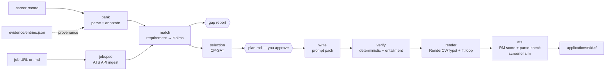

# haha build plan

*23 October 2026. Based on a full read of the repo, the career record, `docs/research/2026-10-22-resume-research.md`, the sibling `evidence/`, `outputs/` and `work/` folders, and the vendored Resume-Matcher 1.4.0.*

## 1. Where things stand

**haha is a well-specified skeleton.** Two commits; ten stage modules that are docstrings only; a CLI that exits "not implemented"; three passing setup tests. Resume-Matcher is installed and working in agent mode (`bin/rm get_status` answers; 0 masters, 0 jobs). Frontend deps are installed.

**The inputs are much richer than the code:**

| Input | Location | What it gives haha |
|---|---|---|
| Master career record (250 KB) | `../outputs/KANISHK_PAUL_MASTER_CAREER_RECORD.md` | 37 cards (`EXP-`, `RES-`, `ENG-`, `LEAD-`) with **110 ready-made bullets**, "best achievement statements", per-card scope/context notes; awards and selections tables (8.1, 8.3); skills bank (11); role-track matrix (12.1); selling rules (12.3); metric-plus-conditions table (15). Sections 17–18 are archival and contain nine prior resumes, which are useful voice samples. |
| Evidence cards | `../evidence/` | 97 entries and 399 claim scopes, each with `master_refs` line ranges into the record and artifact mappings. This is a provenance layer. Its claims are scope labels, not resume text. |
| Apply-now ranking | `../outputs/apply_now_2026-10-23/` | 251 live opportunities, with Lever/Ashby/Greenhouse apply URLs, "lead with" hints and submit requirements. This gives real jobs for testing and a queue for actual use. |
| Opportunity DB | `../outputs/opportunity_refresh_2026-10-22/opportunities.sqlite3` | 642 records with eligibility fields (visa, degree, experience). Usable for knockout checks. |
| Prior resume generator | `~/Downloads/Kanishk_Paul_CV_and_Resumes/` | Five track variants plus a LaTeX style. Useful as layout and wording references only. |

## 2. Corrections to the current design

These came out of the read. Each one changes what gets built.

1. **The evidence bank and masters must leave the repo.** The README puts `data/evidence/` and `data/masters/` inside git. Both are derived from the private record and would contain the phone number, private-repo details and confidential collaboration notes. That conflicts with the rule that haha stays open-source-safe. **Fix:** set a `HAHA_DATA_DIR` that defaults to `../haha-data/` and holds `evidence/`, `masters/`, `jobs/` and `applications/`. The repo keeps only code, a schema, and a small **synthetic** fixture record for tests.
2. **Resume-Matcher judges; haha selects, writes and renders.** RM's preservation contract (`resume_preservation.py`) rejects any tailored resume that drops entries or bullets from its master, and RM allows at most 5 masters. Per-job selection therefore cannot go through RM's tailor flow. `score_resume`, however, accepts an unsaved **draft**, and `parse_check_file` takes any PDF. So per job: haha picks content, writes it, renders it with RenderCV, then asks RM to score the draft and parse-check the PDF. Five track masters remain an optional extra for the RM web UI and tracker. They are not on the critical path.
3. **LLM work runs through prompt packs, not API calls.** No API key, consistent with RM's agent mode. Each LLM step writes a prompt pack (inputs, rubric, JSON schema) to `applications/<id>/work/`. Claude Code fills it in-session. haha validates the returned JSON with pydantic before using it. A small `llm.py` interface keeps an API backend possible later.
4. **Tests must not depend on personal data.** `test_career_record_present` fails on a fresh clone. Split the tests into `unit` (synthetic fixtures, always run) and `local` (real record and RM, skipped when absent).
5. **Some record facts are stale** (the CGPA is a historical snapshot). The record is the only fact source, so corrections need a dated, cited home that the bank merges in.

## 3. Pipeline

Two human gates: the **plan** (what goes on the page, and why) and the **final check report**. Nothing is ever submitted anywhere.

## 4. Milestones

Order: build the foundations and a high-quality bank first, because every later stage depends on the bank. Then a thin end-to-end slice on one real job. Then deepen each stage.

### M0 · Foundations (½ day)
- `config.py`: `HAHA_DATA_DIR` (env var, then `.haha.toml`, then default `../haha-data`). `paths.py` derives from it. Move `data/`, `jobs/` and `applications/` out. Update `.gitignore`, `README.md`, `CLAUDE.md` and the RM skill file.
- `models.py`: pydantic models for `Claim`, `Metric(value, unit, conditions)`, `Entry`, `JobSpec`, `Requirement(kind=basic|preferred|knockout)`, `Coverage`, `Selection`, `TailoredBullet`, `CheckReport`.
- Tooling: ruff and pytest markers `unit`/`local`. Add `tests/fixtures/mini_record.md`, a synthetic record that copies the real structure with fake content.
- **Done when:** `uv run pytest -m unit` passes on a clean clone with no sibling folders present.

### M1 · Evidence bank (`tailor bank`) (2 days)
- **Deterministic parser** for record sections 1, 4–8, 11, 12.1 and 15. Each card becomes an `Entry`: id, title, dates, stack, repo and visibility (from the section 14 table), lead statement, bullets, and context paragraphs (Scope, Context, Protocol, Version note, Disclosure). Each bullet becomes a `Claim` with its source line range.
- **Metric extraction:** pull every number out of each bullet, then attach conditions from the section 15 table and the card's context paragraphs.
- **Provenance:** link claims to `evidence/entries.json` through matching `master_refs` line ranges.
- **Annotation pass (prompt pack, done once):** per entry, record skills (normalised against the section 11 table, with both acronym forms), team credit (Blindfold and Amazon are team work; keep Arnesh Banerjee and Arnesh Gade distinct), public-link eligibility, and track tags from 12.1. Annotations are saved as an overlay YAML that you review, so re-parsing never overwrites them.
- **Staleness check:** the bank stores the record's SHA-256. Every command warns if the record has changed since the bank was built.
- **Done when:** all 37 cards and 110 bullets are parsed; every number in every bullet appears in that claim's metrics; a round-trip test reproduces each bullet's text exactly; `tailor bank --report` lists entries with missing dates or skills.

### M2 · Job spec (`tailor job <url|file>`) (1½ days)
- **Ingest:** detect the vendor from the URL and fetch structured JSON from the public APIs (Ashby `posting-api`, Greenhouse `boards-api`, Lever `v0/postings`). Fall back to a local `.md` file. Save the raw JSON alongside.
- **Extraction (prompt pack):** title, seniority, basic vs preferred requirements with weights, knockouts (mandatory years, degree, work authorisation, location), and canonical keywords with synonyms.
- **Knockout pre-check** against known facts (June 2027 graduation, Kolkata, visa needs) and the opportunity DB's eligibility fields. Fail fast before any tailoring.
- **Done when:** five postings from the apply-now top 15 (Apollo Evals, Prime Intellect CU, Anthropic Post-Training Evals, Cohere MTS Evals, METR) all produce valid specs.

### M3 · Match and gap report (`tailor plan`, part 1) (1½ days)
- **Candidate retrieval:** skill-taxonomy hits plus BM25 over claim text, with a lead-project boost from 12.1.
- **Judgement (prompt pack):** per requirement, label each candidate strong, partial or none, with the quoted claim text.
- `gap_report.md`: supported requirements, weakly supported ones (Unknown risk), and unsupported ones, which are never written into the resume.

### M4 · Selection (`tailor plan`, part 2) (2 days)
- **CP-SAT model:** a boolean per entry and per claim. Line cost comes from character width at the template's font and measure.
- **Constraints:** one-page budget (or two for research roles); required sections (header, education, ≥1 experience); bullet limits per entry; no evidence used twice; at most N projects.
- **Objective:** weighted requirement coverage (basic weighted about 3× preferred), impact (metrics with conditions), recency, and track fit.
- **Output:** `plan.md` explaining why each item was chosen and what was left out. You approve or edit it, and `tailor plan --apply-edits` re-solves with your pins and bans.

### M5 · Write (`tailor write`) (1½ days)
- **Prompt pack per bullet:** source claim, conditions that must survive, the job's vocabulary for the matched requirement, and Google X-Y-Z framing.
- **Voice guard:** a cap on rewrite distance from the source bullet; a banned-phrase list; prior resumes (record section 18) as style seeds.
- The headline uses the posting's exact title when it honestly describes the work. The summary is optional.
- **Output:** `TailoredBullet`s, each with text and claim ids.

### M6 · Verify (`tailor check`, part 1) (2 days)
- **Deterministic checks:** every number, date, proper noun and tool in a bullet must appear in its cited claims (the same idea as RM's `_novel_numbers`, applied against the bank). A metric whose conditions are flagged as required must keep them.
- **Policy lint from 12.3 and 15:** team wording, no private repo links, no "solved N games", no historical figures presented as current, no cross-protocol splicing, Arnesh disambiguation.
- **Style lint:** one date format, both acronym forms, no hidden text, bullet length.
- **Entailment review (prompt pack):** does each bullet follow from its claims?
- **Screener simulation:** each requirement gets Meets, Does not meet or Unknown, with a quoted line, plus an estimated HiredScore A–D grade. Unknowns on supported requirements loop back to M5.

### M7 · Render (`tailor check`, part 2) (1½ days)
- A RenderCV Typst theme: one column, standard headings, Letter for US/CA jobs and A4 elsewhere, plain-text URLs.
- **Extraction check:** pdfminer text must contain no ligature garbage, read in order, and match the source text.
- **Fit loop:** if the render overflows or leaves the last line under 70% full, re-solve M4 with the measured line costs.
- **DOCX copy** for Workday-style portals, via python-docx from the same model.

### M8 · ATS, assembly and orchestration (1 day)
- `ats.py` wraps `bin/rm`: `add_job` with M2's keywords, `score_resume` on the draft, and `parse_check_file` on the PDF.
- `applications/<company>-<role>-<date>/` holds `jobspec.json`, `gap_report.md`, `plan.md`, `resume.pdf`/`.docx`/`.txt`, `provenance.json` (bullet → claims → record lines → evidence artifacts) and `check_report.md`.
- `tailor run <url>` chains every stage and stops at the two gates.
- **Done when:** the M2 five-job set produces resumes with zero verify failures, zero Unknowns on supported basic requirements, and a clean RM parse-check.

### Later (not scheduled)
Five track masters loaded into RM for its web UI and tracker; cover-letter and short-answer packs; LinkedIn consistency check; career-ops discovery and outreach; per-application outcome tracking; two-model-family screener simulation.

## 5. First slice

After M0 and M1, build M2–M8 as thin versions against **one job**: Anthropic *Research Engineer, Post-Training Model Evaluations* (AIO-00244), which uses Greenhouse. Then deepen each stage against the five-job set. Roughly 2 weeks of focused work in total.

## 6. Decisions (23 Oct 2026)

1. **Data folder:** `../haha-data/`.
2. **CGPA:** the current value is shown on resumes. It lives in `haha-data/record_updates.yaml` rather than in an edit to the record, because `../evidence/` pins the record's SHA-256 and line numbers. It supersedes the record's historical snapshot.
3. **Renderer:** both. RenderCV/Typst is the main path; RM's `swiss-single` export is a cross-check in M7.

## 7. Phases

Each milestone is split into phases. A phase is committed and pushed once its tests and lint pass. Work happens on a `build/…` branch, not `main`.

| Phase | Scope | Check |
|---|---|---|
| **P0.1** | `paths.py` with `HAHA_DATA_DIR`, `HAHA_CAREER_RECORD`, `HAHA_PROOF_DIR`; data dirs moved to `../haha-data/`; docs updated | tests pass; no data dirs left in the repo |
| **P0.2** | `models.py`: pydantic models for every stage | model round-trip tests |
| **P0.3** | Synthetic fixture record; `local` marker with auto-skip; ruff | `pytest` passes with no sibling folders; `ruff check` clean |
| **P1.1** | Record reader: sections, cards, paragraphs, bullets, quotes, tables, with line numbers | reader tests on the fixture |
| **P1.2** | Entries and claims: experience, research, engineering, leadership cards; awards and selections tables; education and profile; record updates | all 37 real cards; bullets round-trip byte-exact |
| **P1.3** | Number extraction; section 15 conditions attached to claims; skills, tracks, repos and policy tables | every number in every claim is in its metrics; every section 15 row matches ≥1 claim, or is reported |
| **P1.4** | Bank YAML store, provenance links to `evidence/entries.json`, record SHA staleness check, `tailor bank` and `tailor bank --report` | real bank builds; report reviewed |
| **P1.5** | Skill tagging from the section 11 vocabulary; annotation overlay that survives rebuilds; `tailor bank --annotate` prompt packs | overlay merge tests; packs written for every entry |

**Status (23 Oct 2026):** P0.1–P1.5 done. The real bank holds 63 entries and 214 claims; 213 claims link to proof cards. Left in M1: the annotation pass itself (fill `haha-data/annotations/` from the 54 prompt packs, then review).

M2–M8 phases are added here when each milestone starts.
