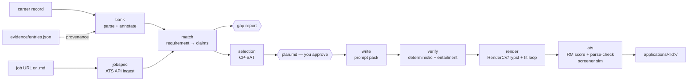

# haha build plan

*23 October 2026. Based on a full read of the repo, the career record, `docs/research/2026-10-22-resume-research.md`, the sibling `evidence/`, `outputs/` and `work/` folders, and the vendored Resume-Matcher 1.4.0.*

## 1. Where things stand

**haha is a well-specified skeleton.** Two commits; ten stage modules that are docstrings only; a CLI that exits "not implemented"; three passing setup tests. Resume-Matcher is installed and working in agent mode (`bin/rm get_status` answers; 0 masters, 0 jobs). Frontend deps are installed.

**The inputs are much richer than the code:**

| Input | Location | What it gives haha |
|---|---|---|
| Master career record (250 KB) | `../outputs/KANISHK_PAUL_MASTER_CAREER_RECORD.md` | 37 cards (`EXP-`, `RES-`, `ENG-`, `LEAD-`) with **110 ready-made bullets**, "best achievement statements", per-card scope/context notes; awards and selections tables (8.1, 8.3); skills bank (11); role-track matrix (12.1); selling rules (12.3); metric-plus-conditions table (15). Sections 17–18 are archival and contain nine prior resumes, which are useful voice samples. |
| Evidence cards | `../evidence/` | 97 entries and 399 claim scopes, each with `master_refs` line ranges into the record and artifact mappings. This is a provenance layer. Its claims are scope labels, not resume text. |
| Apply-now ranking | `../outputs/apply_now_2026-10-23/` | 251 live opportunities, with Lever/Ashby/Greenhouse apply URLs, "lead with" hints and submit requirements. This gives real jobs for testing and a queue for actual use. |
| Opportunity DB | `../outputs/opportunity_refresh_2026-10-22/opportunities.sqlite3` | 642 records with eligibility fields (visa, degree, experience). Usable for knockout checks. |
| Prior resume generator | `~/Downloads/Kanishk_Paul_CV_and_Resumes/` | Five track variants plus a LaTeX style. Useful as layout and wording references only. |

## 2. Corrections to the current design

These came out of the read. Each one changes what gets built.

1. **The evidence bank and masters must leave the repo.** The README puts `data/evidence/` and `data/masters/` inside git. Both are derived from the private record and would contain the phone number, private-repo details and confidential collaboration notes. That conflicts with the rule that haha stays open-source-safe. **Fix:** set a `HAHA_DATA_DIR` that defaults to `../haha-data/` and holds `evidence/`, `masters/`, `jobs/` and `applications/`. The repo keeps only code, a schema, and a small **synthetic** fixture record for tests.
2. **Resume-Matcher judges; haha selects, writes and renders.** RM's preservation contract (`resume_preservation.py`) rejects any tailored resume that drops entries or bullets from its master, and RM allows at most 5 masters. Per-job selection therefore cannot go through RM's tailor flow. `score_resume`, however, accepts an unsaved **draft**, and `parse_check_file` takes any PDF. So per job: haha picks content, writes it, renders it with RenderCV, then asks RM to score the draft and parse-check the PDF. Five track masters remain an optional extra for the RM web UI and tracker. They are not on the critical path.
3. **LLM work runs through prompt packs, not API calls.** No API key, consistent with RM's agent mode. Each LLM step writes a prompt pack (inputs, rubric, JSON schema) to `applications/<id>/work/`. Claude Code fills it in-session. haha validates the returned JSON with pydantic before using it. A small `llm.py` interface keeps an API backend possible later.
4. **Tests must not depend on personal data.** `test_career_record_present` fails on a fresh clone. Split the tests into `unit` (synthetic fixtures, always run) and `local` (real record and RM, skipped when absent).
5. **Some record facts are stale** (the CGPA is a historical snapshot). The record is the only fact source, so corrections need a dated, cited home that the bank merges in.

## 3. Pipeline

Two human gates: the **plan** (what goes on the page, and why) and the **final check report**. Nothing is ever submitted anywhere.

## 4. Milestones

Order: build the foundations and a high-quality bank first, because every later stage depends on the bank. Then a thin end-to-end slice on one real job. Then deepen each stage.

### M0 · Foundations (½ day)
- `config.py`: `HAHA_DATA_DIR` (env var, then `.haha.toml`, then default `../haha-data`). `paths.py` derives from it. Move `data/`, `jobs/` and `applications/` out. Update `.gitignore`, `README.md`, `CLAUDE.md` and the RM skill file.
- `models.py`: pydantic models for `Claim`, `Metric(value, unit, conditions)`, `Entry`, `JobSpec`, `Requirement(kind=basic|preferred|knockout)`, `Coverage`, `Selection`, `TailoredBullet`, `CheckReport`.
- Tooling: ruff and pytest markers `unit`/`local`. Add `tests/fixtures/mini_record.md`, a synthetic record that copies the real structure with fake content.
- **Done when:** `uv run pytest -m unit` passes on a clean clone with no sibling folders present.

### M1 · Evidence bank (`tailor bank`) (2 days)
- **Deterministic parser** for record sections 1, 4–8, 11, 12.1 and 15. Each card becomes an `Entry`: id, title, dates, stack, repo and visibility (from the section 14 table), lead statement, bullets, and context paragraphs (Scope, Context, Protocol, Version note, Disclosure). Each bullet becomes a `Claim` with its source line range.
- **Metric extraction:** pull every number out of each bullet, then attach conditions from the section 15 table and the card's context paragraphs.
- **Provenance:** link claims to `evidence/entries.json` through matching `master_refs` line ranges.
- **Annotation pass (prompt pack, done once):** per entry, record skills (normalised against the section 11 table, with both acronym forms), team credit (Blindfold and Amazon are team work; keep Arnesh Banerjee and Arnesh Gade distinct), public-link eligibility, and track tags from 12.1. Annotations are saved as an overlay YAML that you review, so re-parsing never overwrites them.
- **Staleness check:** the bank stores the record's SHA-256. Every command warns if the record has changed since the bank was built.
- **Done when:** all 37 cards and 110 bullets are parsed; every number in every bullet appears in that claim's metrics; a round-trip test reproduces each bullet's text exactly; `tailor bank --report` lists entries with missing dates or skills.

### M2 · Job spec (`tailor job <url|file>`) (1½ days)
- **Ingest:** detect the vendor from the URL and fetch structured JSON from the public APIs (Ashby `posting-api`, Greenhouse `boards-api`, Lever `v0/postings`). Fall back to a local `.md` file. Save the raw JSON alongside.
- **Extraction (prompt pack):** title, seniority, basic vs preferred requirements with weights, knockouts (mandatory years, degree, work authorisation, location), and canonical keywords with synonyms.
- **Knockout pre-check** against known facts (June 2027 graduation, Kolkata, visa needs) and the opportunity DB's eligibility fields. Fail fast before any tailoring.
- **Done when:** five postings from the apply-now top 15 (Apollo Evals, Prime Intellect CU, Anthropic Post-Training Evals, Cohere MTS Evals, METR) all produce valid specs.

### M3 · Match and gap report (`tailor plan`, part 1) (1½ days)
- **Candidate retrieval:** skill-taxonomy hits plus BM25 over claim text, with a lead-project boost from 12.1.
- **Judgement (prompt pack):** per requirement, label each candidate strong, partial or none, with the quoted claim text.
- `gap_report.md`: supported requirements, weakly supported ones (Unknown risk), and unsupported ones, which are never written into the resume.

### M4 · Selection (`tailor plan`, part 2) (2 days)
- **CP-SAT model:** a boolean per entry and per claim. Line cost comes from character width at the template's font and measure.
- **Constraints:** one-page budget (or two for research roles); required sections (header, education, ≥1 experience); bullet limits per entry; no evidence used twice; at most N projects.
- **Objective:** weighted requirement coverage (basic weighted about 3× preferred), impact (metrics with conditions), recency, and track fit.
- **Output:** `plan.md` explaining why each item was chosen and what was left out. You approve it or write pins and bans in `plan.edits.yaml`, which `tailor plan` applies on every run.

### M5 · Write (`tailor write`) (1½ days)
- **Prompt pack per bullet:** source claim, conditions that must survive, the job's vocabulary for the matched requirement, and Google X-Y-Z framing.
- **Voice guard:** a cap on rewrite distance from the source bullet; a banned-phrase list; prior resumes (record section 18) as style seeds.
- The headline uses the posting's exact title when it honestly describes the work. The summary is optional.
- **Output:** `TailoredBullet`s, each with text and claim ids.

### M6 · Verify (`tailor check`, part 1) (2 days)
- **Deterministic checks:** every number, date, proper noun and tool in a bullet must appear in its cited claims (the same idea as RM's `_novel_numbers`, applied against the bank). A metric whose conditions are flagged as required must keep them.
- **Policy lint from 12.3 and 15:** team wording, no private repo links, no "solved N games", no historical figures presented as current, no cross-protocol splicing, Arnesh disambiguation.
- **Style lint:** one date format, both acronym forms, no hidden text, bullet length.
- **Entailment review (prompt pack):** does each bullet follow from its claims?
- **Screener simulation:** each requirement gets Meets, Does not meet or Unknown, with a quoted line, plus an estimated HiredScore A–D grade. Unknowns on supported requirements loop back to M5.

### M7 · Render (`tailor check`, part 2) (1½ days)
- A RenderCV Typst theme: one column, standard headings, Letter for US/CA jobs and A4 elsewhere, plain-text URLs.
- **Extraction check:** pdfminer text must contain no ligature garbage, read in order, and match the source text.
- **Fit loop:** if the render overflows or leaves the last line under 70% full, re-solve M4 with the measured line costs.
- **DOCX copy** for Workday-style portals, via python-docx from the same model.

### M8 · ATS, assembly and orchestration (1 day)
- `ats.py` wraps `bin/rm`: `add_job` with M2's keywords, `score_resume` on the draft, and `parse_check_file` on the PDF.
- `applications/<company>-<role>-<date>/` holds `jobspec.json`, `gap_report.md`, `plan.md`, `resume.pdf`/`.docx`/`.txt`, `provenance.json` (bullet → claims → record lines → evidence artifacts) and `check_report.md`.
- `tailor run <url>` chains every stage and stops at the two gates.
- **Done when:** the M2 five-job set produces resumes with zero verify failures, zero Unknowns on supported basic requirements, and a clean RM parse-check.

### Later (not scheduled)
Five track masters loaded into RM for its web UI and tracker; cover-letter and short-answer packs; LinkedIn consistency check; career-ops discovery and outreach; per-application outcome tracking; two-model-family screener simulation.

## 5. First slice

After M0 and M1, build M2–M8 as thin versions against **one job**: Anthropic *Research Engineer, Post-Training Model Evaluations* (AIO-00244), which uses Greenhouse. Then deepen each stage against the five-job set. Roughly 2 weeks of focused work in total.

## 6. Decisions (23 Oct 2026)

1. **Data folder:** `../haha-data/`.
2. **CGPA:** the current value is shown on resumes. It lives in `haha-data/record_updates.yaml` rather than in an edit to the record, because `../evidence/` pins the record's SHA-256 and line numbers. It supersedes the record's historical snapshot.
3. **Renderer:** both. RenderCV/Typst is the main path; RM's `swiss-single` export is a cross-check in M7.

## 7. Phases

Each milestone is split into phases. A phase is committed and pushed once its tests and lint pass. Work happens on a `build/…` branch, not `main`.

| Phase | Scope | Check |
|---|---|---|
| **P0.1** | `paths.py` with `HAHA_DATA_DIR`, `HAHA_CAREER_RECORD`, `HAHA_PROOF_DIR`; data dirs moved to `../haha-data/`; docs updated | tests pass; no data dirs left in the repo |
| **P0.2** | `models.py`: pydantic models for every stage | model round-trip tests |
| **P0.3** | Synthetic fixture record; `local` marker with auto-skip; ruff | `pytest` passes with no sibling folders; `ruff check` clean |
| **P1.1** | Record reader: sections, cards, paragraphs, bullets, quotes, tables, with line numbers | reader tests on the fixture |
| **P1.2** | Entries and claims: experience, research, engineering, leadership cards; awards and selections tables; education and profile; record updates | all 37 real cards; bullets round-trip byte-exact |
| **P1.3** | Number extraction; section 15 conditions attached to claims; skills, tracks, repos and policy tables | every number in every claim is in its metrics; every section 15 row matches ≥1 claim, or is reported |
| **P1.4** | Bank YAML store, provenance links to `evidence/entries.json`, record SHA staleness check, `tailor bank` and `tailor bank --report` | real bank builds; report reviewed |
| **P1.5** | Skill tagging from the section 11 vocabulary; annotation overlay that survives rebuilds; `tailor bank --annotate` prompt packs | overlay merge tests; packs written for every entry |
| **P1.6** | Overlay `extra_claims`: promote verbatim note or field sentences to claims, for entries whose content sits only in notes; then the annotation pass | verbatim check rejects paraphrase; real build has no annotation problems |

**Status (23 Oct 2026):** M0 and M1 done. The real bank holds 63 entries and 221 claims after the annotation pass (54 overlays in `haha-data/annotations/`, reviewed in `haha-data/ANNOTATION_REVIEW.md`). 220 claims map to a proof card; that is a mapping, not verification, and proof collection for the account-only cards continues in `../evidence/`.

| **P1.7** | Completed proof work in the bank: proof cards with contribution, evidence summary and artifacts (`bank/proof.yaml`); each claim's proof strength (collected, accepted, account, none) and public links; row-specific card matching for catalog cards; proof shown in annotation packs | strength, links and matching tests; real bank rebuilt |
| **P1.8** | Annotation `claim_proof`: lower a claim's proof strength where its card says that specific claim isn't supported (applied after linking; upgrades refused); then the annotation pass redone against the proof cards | override tests; real bank has no annotation problems |
| **P2.1** | `ingest.py`: detect the ATS from a URL, fetch Greenhouse/Ashby/Lever postings from their public APIs, convert HTML to text, read local files; `tailor job <url|file>` writes `posting.json`, `posting.md` and `raw.json` to the application folder | fixture tests per vendor; three live postings fetched |
| **P2.2** | `jobspec.py`: a prompt pack per posting; Claude writes `jobspec.json`; validation requires every requirement to quote the posting verbatim, the exact title, and keywords found in the text | grounding tests reject paraphrased quotes |
| **P2.3** | Knockout pre-check: candidate facts (`haha-data/candidate.yaml`) and the opportunity DB's gate decision for the posting; `knockouts.md` with pass / condition / blocker per knockout | rule tests for years, degree, authorisation, location |
| **P2.4** | Five real postings from the apply-now top 15 through `tailor job` | five valid specs and knockout reports |

**Status (23 Oct 2026):** M2 done. Five live postings (Anthropic, Apollo Research, Prime Intellect, Cohere, METR) fetched across all three ATS APIs; all five specs pass `tailor job --check`; knockout reports: two "possible with conditions" (on-site abroad, degree in progress), three with no knockouts.

**Status (24 Oct 2026):** proof work complete and in the bank (P1.7–P1.8). Record unchanged, so parsing is identical; proof linking, annotations, bank and M2 checks were rerun on the completed files. Proof backing for 220 record claims: 172 collected sources, 17 user-accepted closures, 31 personal account only. Independent claim audit not yet done. Review in `haha-data/PROOF_REVIEW.md`.

| **P3.1** | `match.py` retrieval: BM25 over claim text blended with whole-entry relevance, skills-bank hits, a boost for the job's lead-track entries; tracks ranked by headline and lead-entry fit (a suggestion the judgement confirms); hidden, superseded and knockout items left out | retrieval tests on the fixture; the Anthropic spec ranks the Evals track first |
| **P3.2** | Judgement prompt pack (`match.prompt.md`): each requirement with its candidates, proof strength, conditions and team credit, plus every eligible claim; Claude writes `match.json` (track, verdict per requirement, supports with verbatim quotes); validation of ids, quotes and verdict consistency | grounding tests reject paraphrased quotes and unknown claims |
| **P3.3** | `gap_report.md` and `tailor plan` part 1: supported, weakly supported (Unknown risk) and unsupported requirements, weighted coverage for basic and preferred asks, proof strength per requirement, knockouts pointed to `knockouts.md` | CLI test on the fixture |
| **P3.4** | The five real jobs through `tailor plan` | five validated `match.json` files and gap reports |

**Status (24 Oct 2026):** M3 done. All five jobs have validated `match.json` files (every support quotes its claim verbatim) and gap reports. Basic coverage: METR 100%, Prime Intellect 100%, Apollo 89%, Cohere 76%, Anthropic 75%. Unsupported asks: LLM post-training (Anthropic, Apollo) and distributed LLM training (Cohere, two asks). Retrieval's track suggestion was overridden on three of five jobs, so M4 reads the confirmed track from `match.json`.

| **P4.1** | Page model in `selection.py`: Letter or A4 from the job's location, line costs per bullet, entry, section and fixed block; same-work exclusions from shared proof cards (award lines excepted), overlay `same_work` links, and one result stated twice | layout and exclusion tests on the fixture |
| **P4.2** | CP-SAT model: a boolean per entry and claim; page budget; required education and ≥1 experience entry; bullet limits per entry; 2–4 projects and ≤3 award lines on one page; exclusions; objective = weighted requirement coverage (basic 3×, responsibility 2×, preferred 1×) plus proof, metrics, recency and track fit | solver tests: budget held, exclusions held, coverage preferred |
| **P4.3** | `selection.json` and `plan.md` (picks with the requirements each covers, line use, what was left out and why); pins and bans from `plan.edits.yaml`; `tailor plan` solves once `match.json` is valid | CLI test with pins and bans |
| **P4.4** | The five real jobs through selection | five plans within budget with no exclusion broken |

**Status (25 Oct 2026):** M4 done. All five jobs have a `plan.md` and `selection.json` within the estimated page budget (Letter 56 lines, A4 60), with no same-work exclusion broken; each solve takes under a second. Matched coverage lost to the page: Anthropic R10 (statistics and experimental design, strong to partial) and METR R2 (graphs and write-ups). Five award/project pairs without a shared proof card were linked with overlay `same_work`. Line costs are estimates until M7 measures the rendered page.

| **P5.1** | `write.py` skeleton: the `Writing` model (`draft.json`: headline, optional summary, bullets citing claim ids, skills); contact line, education, entry headings and dates, and links to the candidate's own public repositories from the bank; skills suggested from the skills bank; `draft.md` rendering | skeleton tests on the fixture |
| **P5.2** | Write prompt pack (`write.prompt.md`): per bullet the source claim, its conditions and team credit, the requirements it supports with their posting quotes, the job's keywords and a character budget from the plan's line budget; voice rules, banned phrases, and voice samples from the record's earlier resumes (facts there may be outdated) | pack tests |
| **P5.3** | Voice guard and `tailor write`: every picked claim cited once and only by its own entry; text within its character budget; no number, ownership word ("led", "solo", "founded") or banned phrase that the cited claims don't support; drift warning when a bullet strays from its sources; headline from the posting or the record's track headlines; skills only from the skills bank | guard tests reject invented numbers and upgraded ownership |
| **P5.4** | Drafts for the five real jobs | five drafts pass the guard |

**Status (25 Oct 2026):** M5 done. All five jobs have a `draft.json` and `draft.md` that pass the guard with no errors or warnings: every planned claim cited once, every bullet within its character budget (4–13 characters to spare at the tightest), no number or ownership word beyond the cited claims, skills only from the skills bank. Headlines use the record's track headlines (Evals for four jobs, Agent infrastructure for Prime Intellect) rather than posting titles that would imply post-training experience or a company job title. The guard is a first line; M6 does the full fact check and entailment review.

| **P6.1** | `verify.py` fact checks per bullet against its cited claims: numbers and years, names and tools (proper and technical terms, compounds part by part), and a kept metric keeping its section 15 condition | fact tests: invented tools, names, years and dropped conditions rejected |
| **P6.2** | Policy and style lint: links only in headings and only to the candidate's public repositories, team work visible and team award lines saying "team", Arnesh disambiguated, no "solved N games", no cited claim that is superseded or hidden, numbers from two claims flagged for a same-protocol check; no first person, hidden characters, numeric dates, mixed quotes or double spaces; both forms of the posting's acronyms | lint tests |
| **P6.3** | Review pack (`verify.prompt.md`): entailment per bullet against its sources, and a screener reading only the resume text who marks each requirement Meets, Unknown or Does not meet with a verbatim quote; `review.json` validated; supported requirements that read as Unknown go back to writing; an A–D grade from the screener's verdicts | review validation tests |
| **P6.4** | `tailor check` part 1 writes `check_report.md`; the five real jobs through it | five drafts with no errors and the screener's grade recorded |

**Status (25 Oct 2026):** M6 done. All five drafts pass `tailor check` with no errors: facts, policy and style clean, every bullet entailed by its claims, and every requirement that the plan supports strongly reads as Meets to the screener. Six wording issues were fixed on the way (a hedge strengthened, "refine" turned into "redirect", a historical test count stated as current, a budget that funded hosting widened to the whole prototype, an acronym without its long form, team work not visible). Estimated screener grades: METR A, Prime Intellect A, Apollo B (basic 79% Meets), Anthropic C (50%), Cohere C (74%); the C grades come from asks the record doesn't support (post-training, distributed LLM training, production systems, published papers), not from the writing.

M7–M8 phases are added here when each milestone starts.
